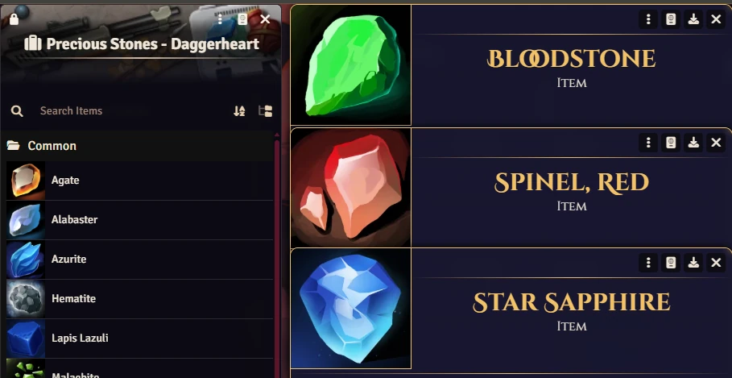

# Precious Stones Pack
Precious stones for fantasy games. Loot, crafting material, magical stone. You choose.

All images use Foundry VTT's built-in core icons (`icons/commodities/...`), so the module ships no artwork of its own.

 

  

## Pathfinder 2e

There are items created for the **Pathfinder 2e** system in a compendium.

## SWADE

There are items created for the **SWADE** system in a compendium.

## Daggerheart

There are items created for the **Daggerheart** system in a compendium.

# Acknowledgements

- DawidIzydor

# License

- Icons are the core icons bundled with Foundry VTT.
